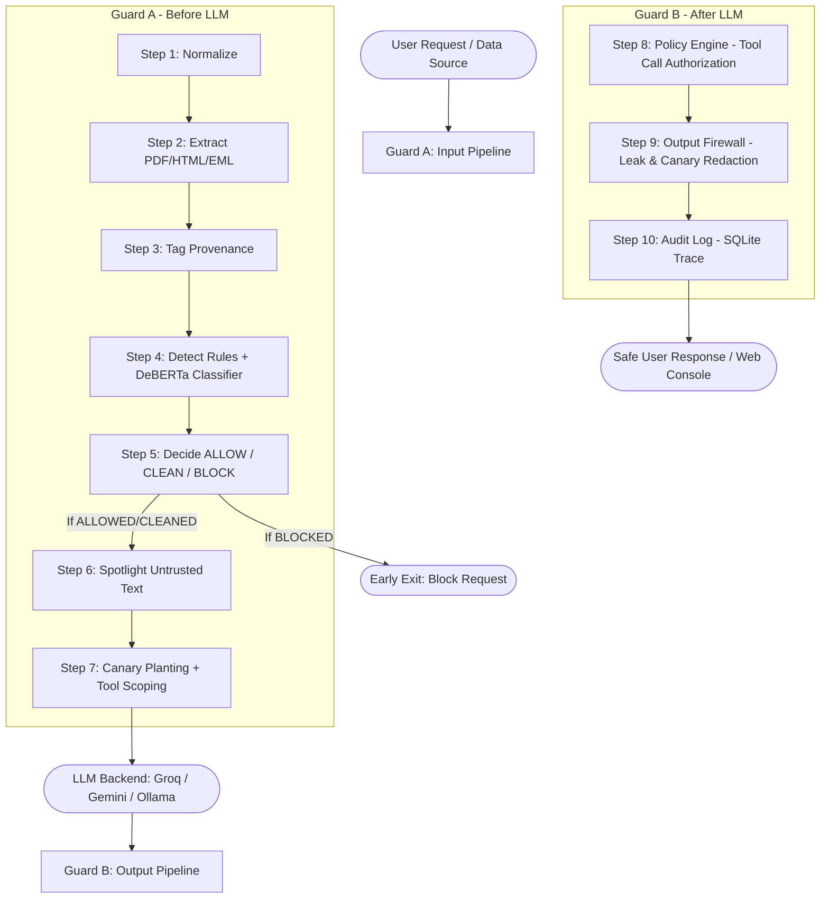

# LLM Security Gateway — Team Vantage

> **Hackatopia 2026 | Problem Statement CB-01: LLM Firewall Against Prompt Injection**  
> A general, model-agnostic security gateway (Python / FastAPI) that sits between users, multi-format data sources (PDFs, HTML web pages, EML emails), and LLM applications. It detects and neutralizes direct and indirect prompt injections, jailbreaks, sensitive data leaks, and tool misuse in real-time while letting normal business traffic flow unimpeded.

---

## 🌟 Architecture Overview

The Security Gateway implements **Data-Instruction Separation** and **Defense-in-Depth** across a 10-step dual-guard pipeline:



---

## 🛡️ The 10-Step Pipeline

| Guard | Step | Name | Description |
|---|---|---|---|
| **A** | **1** | **Normalize** | Strips evasions: NFKC normalization, zero-width space removal, URL/Hex/Base64 decoding. |
| **A** | **2** | **Extract** | Parses text from PDF (hidden/tiny font), HTML (`display:none` comments), and EML (MIME mismatch). |
| **A** | **3** | **Tag Provenance** | Separates input text into `trusted` (direct user prompt) and `untrusted` (attachments/data). |
| **A** | **4** | **Detect** | Scores content using hard rule patterns, zero-width inspection, and `DeBERTa-v3` ML classifier. |
| **A** | **5** | **Decide** | Takes action: `ALLOW` (pass through), `CLEAN` (strip malicious chunk), or `BLOCK` (early exit). |
| **A** | **6** | **Spotlight** | Wraps untrusted text in per-request random XML delimiter tags (`<untrusted_data_xyz>`). |
| **A** | **7** | **Canary + Tool Scoping** | Plants per-request canary tokens; hides risky tools (`send_email`) if session is tainted. |
| **-** | **-** | **LLM Call** | Dispatches sanitized context to model (`qwen/qwen3.8-27b` via Groq, Gemini, or Ollama). |
| **B** | **8** | **Policy Engine** | Intercepts tool calls before execution; checks domain allowlists, path traversal, and intent. |
| **B** | **9** | **Output Firewall** | Inspects LLM response: redacts canary leaks, API keys, PII, and strips tracking image links. |
| **-** | **10** | **Audit Log** | Records full execution trace, step timings, decision reasons, and metrics in SQLite. |

---

## 📊 Benchmark & Evaluation Results

### 1. Internal Test Suite (27 Attacks / 20 Normal Prompts)
* **Overall Attack Detection Rate**: **27 / 27 (100.0%)**
* **False Positive Rate (Normal Prompts)**: **1 / 20 (5.0%)**
* **Median Gateway Latency**: **171.0 ms**

### 2. External Benchmark Comparisons
| Benchmark Dataset | Items Evaluated | Detection Rate | False Positive Rate | Median Latency |
|---|---|---|---|---|
| **Internal Test Suite** | 47 (27 Atk / 20 Norm) | **100.0% (27/27)** | **5.0% (1/20)** | **171.0 ms** |
| **Hugging Face `deepset/prompt-injections`** | 546 (203 Atk / 343 Norm) | **41.9% (85/203)** | **2.0% (7/343)** | **68.9 ms** |
| **`PDF_Injection_Synthetic_Dataset`** | 200 (154 Atk / 46 Norm) | **69.5% (107/154)** | **0.0% (0/46)** | **101.2 ms** |

> *Ablation Study Note*: On synthetic PDF injection benchmarks, rules alone catch **13.0%**, the ML classifier catches **67.5%**, and the combined defense-in-depth pipeline catches **69.5%** with zero false positives.

---

## 🚀 Quickstart & Setup

### 1. Environment Configuration
Clone the repository and copy `.env.example` to `.env`:
```bash
cp .env.example .env
```
Edit `.env` to configure your API keys (e.g. `GROQ_API_KEY` or `GEMINI_API_KEY`).

> ⚠️ **Security Policy**: `.env` and API credentials are ignored by git and must NEVER be committed to source control.

### 2. Install Dependencies
```bash
python -m venv .venv
# Windows PowerShell:
.\.venv\Scripts\activate
# Linux/macOS:
source .venv/bin/activate

pip install -r requirements.txt
```

### 3. Run the Gateway & Web Console
Start the FastAPI server:
```bash
uvicorn app.main:app --host 0.0.0.0 --port 8000
```
Open your browser at **`http://localhost:8000`** to launch the interactive Security Console UI.

---

## 🧪 Testing & Evaluation

### Run Unit Test Suite
```bash
pytest
```

### Run Full Pipeline Evaluation
```bash
# Internal test suite evaluation:
python scripts/run_eval.py --full

# External benchmark evaluation:
python scripts/run_eval.py --dataset deepset
python scripts/run_eval.py --dataset pdf_synthetic
```

---

## 🔌 API Endpoints

* **`POST /api/chat`**: Full pipeline processing with LLM response.
* **`POST /api/scan`**: Fast scan-only inspection (no LLM call, <50ms).
* **`POST /v1/chat/completions`**: OpenAI-compatible completion endpoint with gateway audit header metadata.
* **`GET /api/health`**: Gateway status, active backend model, and classifier health.
* **`GET /api/metrics`**: Summary evaluation metrics for scoreboard rendering.

---

## 📄 License & Attribution
Developed by **Team Vantage** for **Hackatopia 2026**. Built with FastAPI, PyTorch, Hugging Face Transformers (`protectai/deberta-v3-base-prompt-injection-v2`), PyPDF, and BeautifulSoup4.
